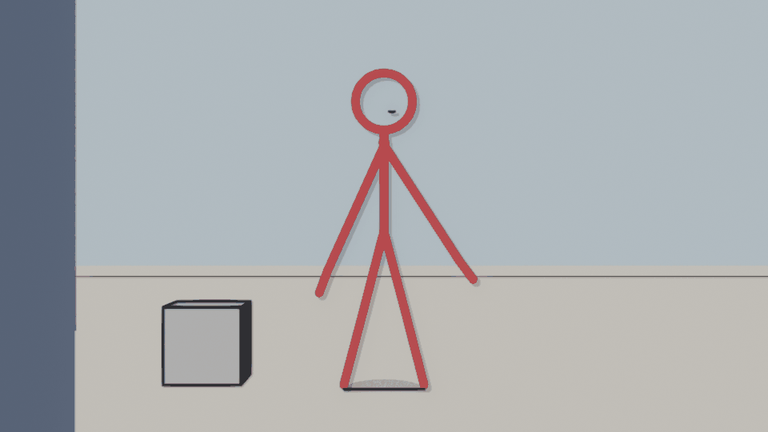

# Blender track of the Toon City pipeline

The same studio departments as `.claude/agents/`, in Blender 4.3+ (Grease
Pencil v3), as a tested Python toolkit. Use it from the Scripting tab, or headless:

```bash
blender -b -P blender_pipeline/build_demo.py -- --out demo/demo.blend --render 1,8,30
```

`build_demo.py` builds a whole demo episode, one step per department, and runs
25 checks: IK feet stay planted, knees bend forward, the mouth swaps on the right
frame, arms oppose legs, the shake fits its tier, and shots cut end to end. It
exits non-zero if any check fails. Verified on Blender 5.0.1.



## Steps, one function each

| # | department (agent) | step | `toonkit` function |
|---|---|---|---|
| 1 | coordinator | studio folders | `make_studio_tree(root)` |
| 2 | coordinator | 1920×1080, 24 fps, Frame Dropping | `setup_project()` |
| 3 | rigger | skeleton in head units | `build_biped_armature(H=…)` |
| 4 | rigger | leg IK + pole, pole angle solved | `add_leg_ik(rig, "L")`, `solve_pole_angle()` |
| 5 | rigger | drawing per bone, exact binding | `draw_stick_character()`, `bind_layers_to_bones()` |
| 6 | background | palette materials, painted cards | `gp_material()`, `flat_material()` |
| 7 | layout | camera, multiplane layers, DoF | `setup_camera()`, `build_multiplane()`, `add_painting()`, `depth_of_field()` |
| 8 | lip sync | 9-viseme mouth library + Fixed Frame swap | `setup_mouth_library()`, `key_visemes()`, `rhubarb_cues()` |
| 9 | key animator | 4-pose walk through IK | `walk_cycle()`, `key_offsets()`, `key_swings()` |
| 10 | in-between | interpolation / easing | `set_interpolation()`, `camera_move(ease=…)` |
| 11 | layout | hand-held drift, impact shake (style-bible tiers) | `handheld()`, `impact_shake(tier=…)` |
| 12 | compositor | line art for 3D props | `line_art(collection)` |
| 13 | compositor | lights, drop shadow, glow, contact shadow | `add_key_light()`, `light_layers()`, `drop_shadow_fx()`, `glow_fx()`, `contact_shadow()` |
| 14 | compositor | bloom / soft blur nodes | `setup_compositor(glare="Bloom" or "Fog Glow")` |
| 15 | coordinator | fast viewport | `draft_viewport(on=True)` |
| 16 | coordinator | shot scenes → master edit + audio | `new_shot()`, `assemble_master()` |
| 17 | delivery | preview / phone / PNG / EXR outputs | `set_output(scene, mode, path)` |
| 18 | coordinator | asset library, link + override | `mark_character_asset()`, `register_asset_library()`, `link_character()` |

The manual (UI) steps and where they differ in current Blender are in
[`docs/BLENDER_GUIDE.md`](docs/BLENDER_GUIDE.md).
