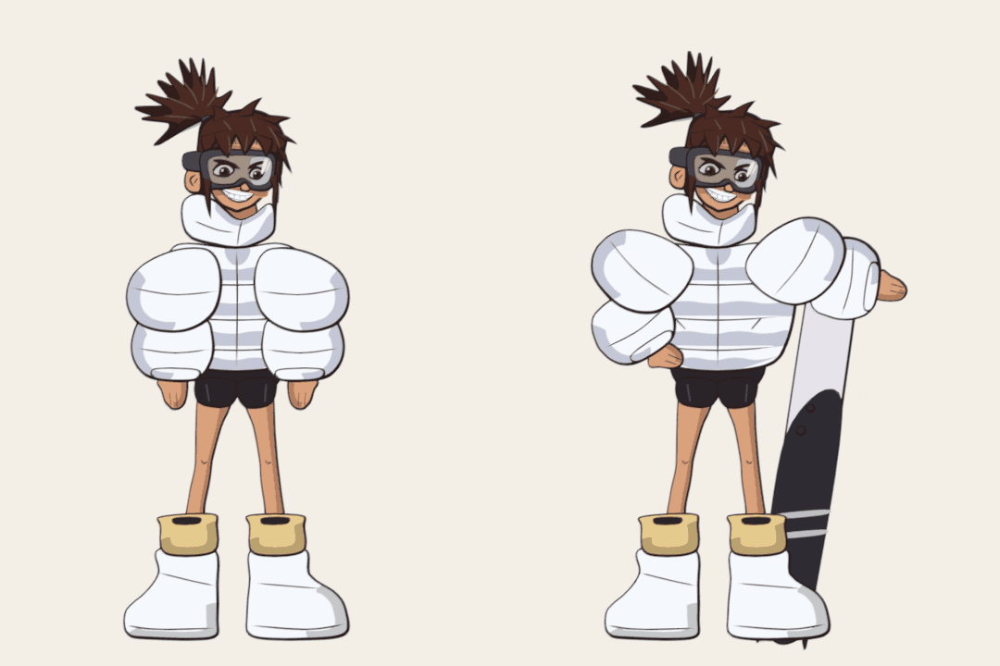
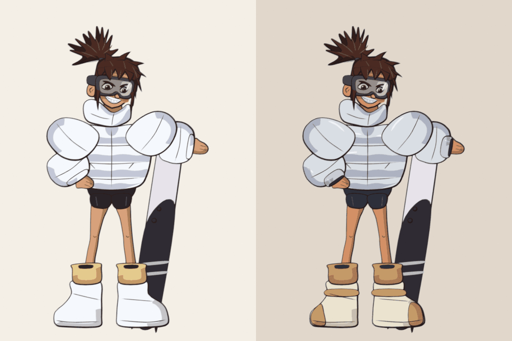
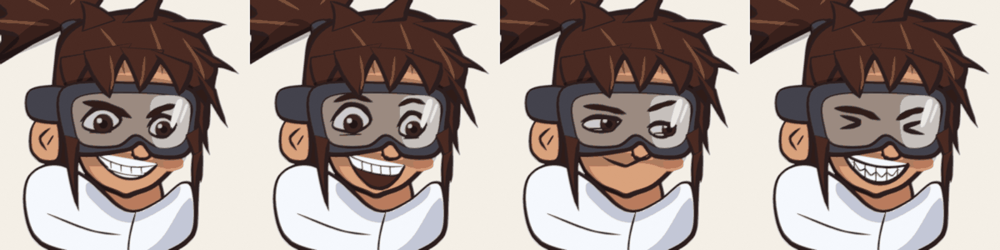

# Characters

## CH_Snowboarder: the spunky snowboarder

Traced from the model sheet in `ref/snowboarder_sheet.jpg` into a rigged Grease
Pencil cut-out puppet (`snowboarder.py`): 25 layers, each bound to one bone;
flat cel fills from the sheet's swatches; dark-brown ink with a brushy, tapering
line; leg IK with outward knees; boots that ride the IK targets; a 9-shape
mouth library drawn in her style (her toothy smirk is the rest shape); and a
separate snowboard prop.



**Two looks**, one rig: `build(look="sheet1")` is the white puffer from
`ref/snowboarder_sheet.jpg`; `build(look="sheet2")` is the blue-grey puffer
with nylon sheen, metal tube cuffs and cream/tan boots from
`ref/snowboarder_sheet2.jpg`.



**Expressions** (from the second sheet's heads), swapped per frame like the
mouths: eyes `GLARE`, `HAPPY`, `SIDE`, `SQUINT`; mouths are the 9 visemes plus
`GRIT` (gritted laugh) and `SMIRK` (closed side smirk).
`express(art, frame, eyes="SQUINT", mouth="GRIT")`.



```bash
# stills: rest pose, sheet pose, front-walk keys, mouth chart, and a 2 s walk+talk clip
blender -b -P blender_pipeline/characters/render_snowboarder.py -- --out renders/ --views rest,sheet,walk,faces,mouths,anim [--look sheet2]
blender -b -P blender_pipeline/characters/test_snowboarder.py        # 18 checks
```

| function | what it does |
|---|---|
| `build()` | rig + artwork + mouth library + board; returns `(rig, art, board)` |
| `pose_sheet(rig)` | the sheet pose: hand on hip, arm over the board, head cocked |
| `walk(rig)` | front-view walk in place (knee lifts, bounce, ponytail follow-through) |
| `talk(art, cues)` | lip sync from `(seconds, viseme)` cues, or Rhubarb JSON via `toonkit.rhubarb_cues` |

**How the comic look is built** (each is checked in `test_snowboarder.py`):

| technique | what it does | code |
|---|---|---|
| Brush line profile | every outline pinches to a point at sharp corners (hair tips, collar points), runs thin on the lit top-left and heavy on the shadow side, with pressure wobble; open lines taper at both ends. Hair locks reach a 37:1 thick-to-thin ratio | `line_profile()`, `lock()` |
| Multiply cel shadows | 17 `<part>_Shd` layers, Multiply blend at 45%, holding crisp dark-blue (cloth) / brown (skin, hair) shadow shapes: under each quilted band, inside the collar, under the goggles, down the jaw, on the legs | `shade()`, `band_shadow()`, `toonkit.shadow_layer()` |
| Rubber-hose joints | each leg is one continuous shape whose points blend smoothly from thigh to shin to boot across the knee and ankle, so bends curve instead of hinging | `toonkit.bind_smooth_chain()` |
| Puffer lattices | a 3x3 lattice rides on the torso and each sleeve bone with `Puff` and `Squash` shape keys; the walk squashes the jacket on each contact and re-inflates it, sleeves 2 frames behind | `toonkit.add_puff_lattice()`, `toonkit.key_puff()` |

**Adding a character in this style:** trace its parts in sheet pixels with
`shape()` (fill + ink), `ink()` (tapered lines) and `crescent()` (one shade
tone), list layers back to front with their bones in `LAYERS`, and give it
`JOINTS`. It then works with every toolkit helper (IK, walks, lip sync,
camera, compositing).

Limits: one drawn view (front 3/4). The second sheet's back-3/4 crouch is a
second view; drawing it (and a side view) as its own layer set is the next
step, so she can turn and walk across the screen.
