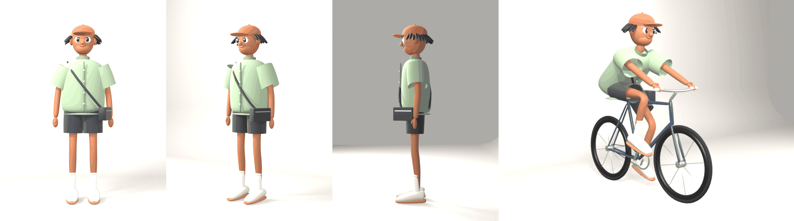

# 3D characters

## CH_FixieRider (`fixie_rider.py`)

An original stylised 3D character in the soft "3D-render character design"
look: very long thin legs, oversized boxy streetwear (sage work shirt with
buttons, baggy charcoal shorts, tall white socks, chunky cream sneakers with
gum soles), a rust cap over short twists, a crossbody bag, big friendly eyes
and a grin; on a fixed-gear bike in a soft grey studio.



How it is built (all code, Blender 4.3+/5.0):
- **Shapes:** every part is a lofted tube (`tube`, elliptical rings for boxy
  clothes) or a scaled sphere (`blob`), smoothed with Subdivision Surface.
- **Rig:** a skeleton with IK legs and arms (pole angles solved so the rest
  pose doesn't move). Clothes, head and shoes ride their bones; the bare legs
  and arms are single meshes skinned along the chain (`skin_chain`), blending
  across the knee and elbow so they bend smoothly.
- **Bike:** tubes, tori and discs; the crank turns and, as on a fixie, the
  wheels turn with it. Her feet (IK) ride the pedals and the hands hold the
  grips, so `pose_ride(rig, bike, crank_deg)` is a real pedal stroke.
- **Studio:** a curved cyclorama with key, fill and rim area lights.

```bash
blender -b -P blender_pipeline/characters3d/fixie_rider.py -- --out renders/fixie --views sheet,ride,loop --frames 24
```

## The studio look (vinyl-toy quality pass)

What separates a "3D character design" render from a primitive-built one,
and where it lives in `fixie_rider.py`:

| | before | now |
|---|---|---|
| Faces | spheres stuck on an egg | `sculpt_head`: a dense sphere displaced like sculpt strokes - eye sockets under a brow ridge, cheekbones, nose bridge into a tip, philtrum and lips, a narrowing jaw and a defined chin; eyeballs set in the sockets; `lid_shell` eyelids that wrap the eye (rim = lash line), opened or closed by rotation; heavy tapered brows, one cocked; a crooked smirk |
| Garments | smooth balloons | `tube(..., crease=, facet=)`: rounded-box sections, creased corner seams and crisp hems through subdivision, slightly faceted panels |
| Materials | default plastic | `mat`: roughness 0.95, no specular, IOR 1.1, noise (scale 500) bump at 0.02 for a clay grain; eyes and metal stay glossy |
| Light | big soft boxes | a 0.1 m key for crisp shadows, soft dim fill, small rim, and a separate soft light on the cyclorama for a value gradient |
| Grade | Standard | `grade`: AgX + Medium High Contrast; `film_grain` adds a whisper of colour grain to stills |

## CROSSWALK (`street_scene.py`)

He cruises down a golden-hour street on his fixie; a girl steps out from
behind a parked car onto the crosswalk; he locks his legs, skids into a
stoppie and stops nose to nose with her - and is completely struck.
13 s, seven shots laid out with the studio's camera rules (establishing
wide, tracking, POV reveal, close-up push-in, side wide for the action,
slow two-shot push-in, dazed close-up), shallow depth of field on the
emotional beats.

- **Her** (`build_girl`): an original character on the same rig: black
  blunt bob, gold hoops, lashed eyes, mustard cardigan over a white tee,
  wide light-wash jeans that bend at the knee, platform sneakers, red bag.
- **The street** (`build_street`): road with lane and centre lines, zebra
  crossing and stop lines, kerbs and paved sidewalks, rows of pastel
  facades with windows, sills, cornices, shopfronts and striped awnings,
  lamps, trees, a crossing signal, a parked hatchback, a hydrant, a bench;
  low warm sun.
- **Physics:** cruise at 4.2 m/s, skid at 7 m/s^2; his start point is
  solved so he stops with the front tyre just short of her. The bike
  pitches about the front contact (a stoppie) and drops back with a bounce;
  the fixed gear stops the crank when he locks up.
- **Her walk:** planted feet on a 60/40 stance/swing cycle, hip bob, arm
  swing; she stops, turns to him, then walks on.
- **His face** (`Face`): eyes snap wide with shrinking pupils on the
  reveal, then the awe - pupils bloom, sparkles, blush, jaw drops - while
  hearts rise and pop above him.
- **Sound** (`street_scene_audio.py`): city air and birds, a lo-fi groove
  that cuts dead on the skid, chain whir, tyre screech, her gasp, a
  heartbeat and a rising chime for the moment.

```bash
blender -b -P blender_pipeline/characters3d/street_scene.py -- --out renders/crosswalk --frames 1-312
python3 blender_pipeline/characters3d/street_scene_audio.py --out renders/crosswalk
```
